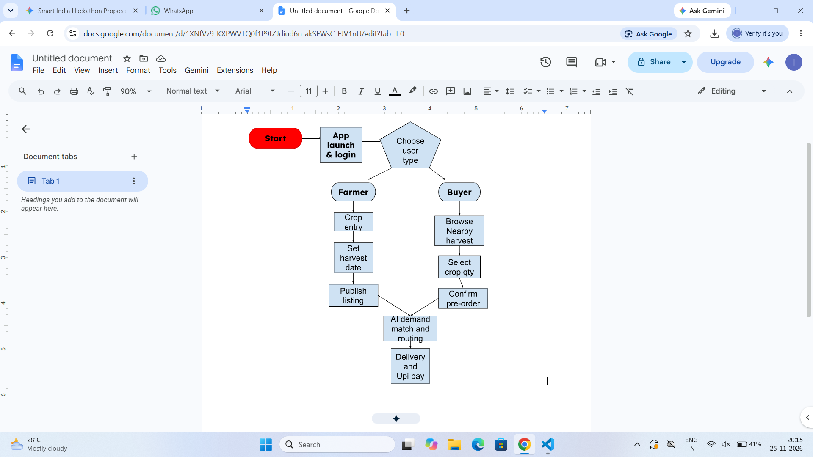

# Smart India Hackathon Workshop
# Date: 24/11/2026
## Reference Number: 26011904
## Name: Indrajeet Kar

## Problem Title
SIH 26033: Multiple intermediaries reduce farmers earnings and increase consumer prices.

## Problem Creater's Organization
Ministry of Consumer Affairs, Food & Public Distribution

## Theme
Agriculture, FoodTech & Rural Development

## Problem Description
Expected Solution: Create a digital marketplace that:

• Connects farmers/FPOs directly with consumers and bulk buyers.
• Provides logistics support.
• Uses AI for demand forecasting and route optimization.

Benefits:

• Better prices for farmers.
• Lower prices for consumers.
• Reduced supply chain inefficiencies.

## Proposed Solution
We propose KisanSetu, a simple mobile and web platform that connects farmers and farmer groups directly with regular shoppers, restaurants,bulk buyers and cutting out middlemen so both sides get a better deal. Instead of selling through multiple agents and markets where extra cuts are taken at every step, farmers can list their growing crops a few days before harvest. Our system groups small harvests from nearby farms into larger orders, plans smart pickup routes with local delivery vans, and sends the produce straight to buyers.

Right now, middlemen take a big chunk of the money while farmers struggle with low rates and buyers pay high prices. By going direct, farmers keep a much bigger share of what people pay, while families, local shops, and restaurants get fresher food for less money. Our smart forecasting also helps farmers know which crops are in high demand and when to harvest so they don't end up selling in a rush at low prices.

What makes our solution stand out:

Combining Small Harvests Together: A single small farmer might not have enough produce for a big order on their own, so our app combines harvests from nearby farmers in the same area to meet larger orders easily.

Easy Voice Entry in Local Languages: Farmers don't need to type or read complicated menus—they can speak in their own local language to list their crops and expected harvest dates.

Faster Routes for Fresh Crops: Fruits and vegetables spoil quickly, so our route planning gives priority to delicate crops and picks up from nearby farms in one smooth loop to cut travel time and spoilage.

## Technical Approach
We build KisanSetu using practical, easy-to-maintain software tools that work smoothly even on slower phones and rural internet connections:

Mobile App, Website & Voice Tools: A simple mobile app for farmers that works in local languages and supports voice entry, paired with a clean website and mobile screen for buyers to place orders and track deliveries.

Backend & Database: A reliable central system that handles user accounts, crop listings, order matching, and live delivery status, while storing location data so nearby farms and buyers can be grouped quickly.

Smart Planning & Forecasting: Prediction tools that estimate how much of each crop buyers will need based on season, weather, and past sales, plus route-planning software that finds the fastest pickup path for delivery vans so fresh food reaches buyers quickly.

Payments & Open Connections: Safe digital payment tools that send money directly to the farmer's bank account via UPI once delivery is confirmed, along with open connections so local shops and delivery services can join easily.

How We Build and Run It:

1.Sign Up & Basic Check: Farmers and local farmer groups join with their phone number and basic ID, while shoppers, local stores, and restaurants sign up to buy.

2.List Upcoming Crops: Farmers speak into the app in their local language—or tap simple buttons—to share their crop type, expected harvest amount, and ready date.

3.Match Demand & Group Orders: The system checks buyer demand, groups nearby farms with similar crops to fill bigger orders, and shows clear, fair prices.

4.Plan Routes & Deliver: Once daily orders are set, the system creates a smooth pickup loop for local vans to collect produce from nearby farms and deliver straight to buyers.

5.Check Quality & Pay Right Away: Produce is checked at pickup and delivery, and payment goes straight to the farmer's bank account through UPI without delay.

## Feasibility and Viability
Our solution is practical, low-cost, and easy to roll out using tools people already use every day:

Why It Can Work Easily: Most rural areas now have good mobile internet and UPI payment access, and thousands of village farmer groups already exist across the country. Instead of spending huge amounts of money building new warehouses or buying trucks, KisanSetu uses existing village collection centers as pickup points and partners with local mini-truck and tempo drivers for deliveries. The platform sustains itself by taking a small 3–5% service fee from bulk buyers, keeping it completely free for farmers.

Possible Challenges:

Disputes Over Crop Quality: Buyers might complain that the vegetables or fruits delivered aren't as fresh or well-sorted as expected.

Hesitation to Use New Apps: Some older farmers may feel uncomfortable using a smartphone app or trusting online payments at first.

Spoilage in Hot Weather: Delicate fruits and vegetables can spoil quickly during summer travel if not handled properly.

How We Will Solve Them:

Village-Level Quality Checks: Train local youth from farmer groups to check and grade crops at the village pickup point using simple phone photo guidelines before loading the vans.

Local Helpers & Instant Bank Transfers: Appoint friendly local village volunteers to guide farmers through their first few listings, and send money directly to their bank accounts via UPI the moment crops are handed over so they trust the system right away.

Shared Cold Storage Tie-Ups: Partner with existing local solar cold-storage units near farm clusters to keep delicate produce cool while waiting for pickup.

## Impact and Benefits
Who Benefits Most: KisanSetu directly helps small and marginal farmers,who make up the majority of Indian agriculture,get fair, predictable pay without relying on middlemen, while giving everyday families, local grocery shops, and restaurants fresher farm produce at lower prices.

Financial Benefits: Farmers earn more from every harvest because middleman commissions are removed, and buyers save more on their daily fruit and vegetable bills.

Community & Social Benefits: Steady, transparent income helps farming families avoid debt traps, turns village farmer groups into stronger local businesses, and creates new rural jobs for youth in sorting, grading, and local delivery.

Environmental Benefits: Faster, direct farm-to-buyer delivery cuts down the huge amount of fruits and vegetables that normally rot in slow wholesale markets, while smart pickup routes mean fewer half-empty trucks on the road and less fuel wasted.
## Research and References
National Agriculture Market (e-NAM): https://enam.gov.in — Studied how India's online mandi system works so our app can check daily crop prices and ensure farmers always get fair, transparent rates.

Government Reports on Food Wastage (ICAR-CIPHET): https://ciphet.res.in — Referenced national studies showing that around 15–20% of fruits and vegetables spoil before reaching buyers due to slow transport and too many middlemen, proving why faster direct delivery is needed.

Small Farmers' Agribusiness Consortium (SFAC): https://sfacindia.com — Used government guidelines on village farmer groups (FPOs) to design how small farmers can pool their harvests together and check crop quality at local village centers.

Open Network for Digital Commerce (ONDC): https://ondc.org — Referenced India's open digital shopping network so that farmers on our app can also reach more buyers, local stores, and delivery partners across different platforms.

Smart Route Planning Tools (Google OR-Tools): https://developers.google.com/optimization/routing — Referenced open-source route planning methods to figure out how delivery vans can pick up crops from multiple nearby farms in the shortest possible time.

 This whole process can be made possible with help of government cooperation and government-aid.
